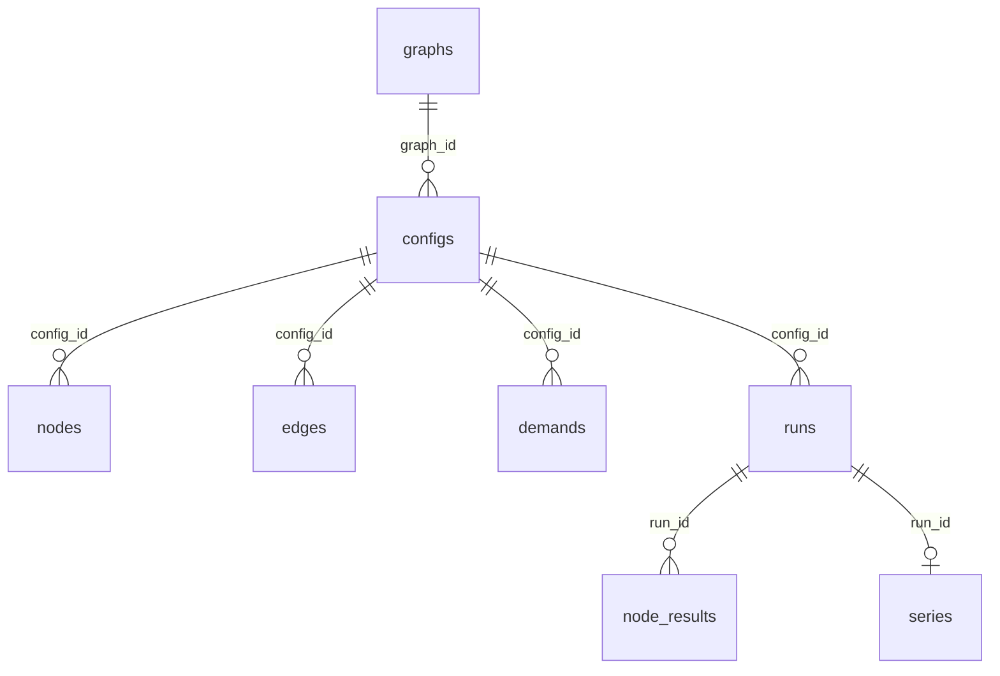

# The dataset

--8<-- "generated/source.md"

## Key numbers

--8<-- "generated/key_numbers.md"

## Three words to know

| Word | In the code | Meaning | How many |
|---|---|---|---|
| **Network** | graph | The map of who supplies whom | Up to 50 per size |
| **Setup** | config | One network with all its numbers, for one industry | 4 per network, plus what-if copies |
| **Run** | run | One 5-year simulation of a setup | 1 per setup (5 for 10% of them) |

On average, one network gives 4 base setups and about 8 runs.

## How the files are organised

Everything is stored as **Parquet** tables [^parquet]. Parquet is a compressed, column-based format that
Python (pyarrow, pandas, polars), R and Spark can all read. A reader can load only the columns and rows it
needs. Each table is a folder of files:

```text
dataset/
├── meta.json          all build settings, versions and counts
├── graphs/            one row per network
├── configs/           one row per setup
├── nodes/             one row per node of each setup (its numbers)
├── edges/             one row per link of each setup
├── demands/           one row per customer stream of each setup
├── runs/              one row per run: the main catalogue and network results
├── node_results/      one row per run × node: node results
├── series/            one row per run: the day-by-day history (large; optional)
└── SHA256SUMS         checksums, to check that a download is complete
```



Every id is a whole number. A node's id is its position in the network (0 … n−1) and is the same in every
table. The files are sorted by split and industry, so reading only "test, pharma" skips everything else.

!!! tip "The day-by-day history is optional"
    The `series/` folder holds most of the bytes. If you only need the summary results, skip it when
    downloading. The loader never reads it unless asked.

## The tables

### `graphs`: one row per network

| Column | Meaning |
|---|---|
| `graph_id` | Network id |
| `topology` | `echelon` (layered) or `random_tree` |
| `roles` | One letter per node: S supplier, M factory, I warehouse or shop, D customers |
| `src`, `dst` | All links, as two lists (link k goes from `src[k]` to `dst[k]`) |
| `n`, `s`, `m`, `i`, `d` | Number of nodes, and of each kind |
| `depth` | Longest path from a supplier to a customer |
| `dc_tiers` | Number of warehouse layers (layered networks) |
| `multi_parent` | Number of nodes with more than one supplier |
| `size_band` | `base` (up to 150 nodes) or `large` |
| `split` | `train`, `val` or `test` |
| `graph_hash`, `dup_of` | Fingerprint; id of the first network with the same fingerprint |

### `configs`: one row per setup

| Column | Meaning |
|---|---|
| `config_id`, `graph_id` | Setup id, its network |
| `scenario` | Industry: `fmcg`, `electronics`, `pharma`, `industrial` |
| `regime` | `stress` (badly run on purpose) or `control` (well run) |
| `base_config_id` | Equal to `config_id` for a base setup; for a what-if copy, the id of its base |
| `variant`, `variant_node`, `variant_start`, `variant_value` | The what-if change: kind (`outage`, `capacity`, `service`), where, when, how much |
| setup-wide settings | `margin_factor`, `service_mean`, `bias_mean`, `season_amp`, `trend`, `outage_p`, `finite_supply`, `holding_rate_year`, … |

### `nodes`, `edges`, `demands`: the numbers of each setup

- **`nodes`**: one row per node. Its flow per day, forecast, delivery time, stock rule (`s`, `S`, `Q`,
  `review`), safety factor, factory batch size, supplier rate and store, breakdown rates, prices and costs.
- **`edges`**: one row per link: average delivery time and its spread, order share, cost per order.
- **`demands`**: one row per customer stream: units per day, orders per day, order size, season, growth.

### `runs`: one row per run

The **catalogue**. Each row repeats the most useful setup columns (industry, size, regime, split,
what-if kind), so most filtering needs this table only. It also holds the network results listed in
[How a simulation runs](simulation.md#what-is-measured), the warm-up check, run time and status
(`ok` or `error`).

### `node_results`: one row per run × node

Each node's own results over the measured years: fill rate, demand, shortage, shipped, average stock,
money in and out, breakdown days, observed delivery time.

### `series`: one row per run

Eight lists of 1,825 daily values: `cust_demand`, `cust_served`, `ext_revenue`, `net_cost`, `profit`,
`book_profit` (amounts for that day), and `inventory`, `site_backorder` (levels at the end of the day).
Day 1 is the first element; the first 365 days are the warm-up.

Units of every column are stored inside the files (Parquet metadata key `units`).

## Where to get it

The dataset will be published on **Hugging Face** (link to be added). The code that builds it is in this
repository, so the dataset can be rebuilt exactly from the same seed.

[^parquet]: Apache Parquet. <https://parquet.apache.org/>
