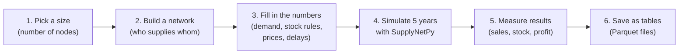

# SupplyNetBench

A large collection of **simulated supply chains**. Each one is a small world of suppliers, factories,
warehouses, shops and customers, run day by day for five years on a computer. For every supply chain
the dataset stores its full description (who supplies whom, and every number that controls it) together
with what happened in the simulation (how much was sold, how much stock was held, how much money was
made or lost).

The dataset is made with [SupplyNetPy](supplynetpy.md), an open-source supply-chain simulator from
IIT Goa [^snp].

--8<-- "generated/source.md"

## What it is

- **Many different supply chains.** Thousands of network shapes, from 10 to about 300 nodes. Most are
  layered like real chains (suppliers → factories → warehouses → shops → customers); some are random
  trees that test unusual shapes. See [How a network is built](network.md).
- **Four industries.** Groceries, electronics, medicines and industrial spare parts. Every network is
  run once for each industry, with numbers typical of that industry (delivery times, prices, order
  sizes). See [How the numbers are chosen](numbers.md).
- **Good times and bad times.** Some setups are run well, others badly on purpose (wrong forecasts,
  price wars, broken factories). This makes sure the data contains failures, not only success.
- **Matched "what-if" pairs.** Some setups have copies that differ in exactly one thing (a breakdown,
  a smaller factory, a different safety stock). The customers are the same, so any difference is
  caused by that one change. See [How a simulation runs](simulation.md).
- **Ready for machine learning.** Every network is already put into a training, validation or test
  group, and a loader turns each setup into graph arrays. See [Finding your way around](navigate.md).

## Why it is needed

Running a detailed supply-chain simulation takes seconds to minutes. A planner who wants to compare
thousands of designs ("Should we add a warehouse? Which supplier should we drop?") cannot wait that long
for each one. A machine-learning model trained on many simulated chains could give an answer in
milliseconds. Graph neural networks are a natural fit, because a supply chain *is* a graph [^gnn].

Such a model needs a large, varied and honest training set:

- **Large**, so it sees enough examples.
- **Varied**, so it learns about shape, industry and policy, not one fixed case.
- **Honest**, so every number is internally consistent and every assumption is written down.

Real company data is private, small and never covers "what if". Simulation fills that gap.

This dataset builds on the GNN supply-chain dataset of Lone and Karanjkar [^gnn]. It adds larger and
deeper networks, four industries, disruptions, seasonal demand, deliberately badly run setups, what-if
pairs and the day-by-day history of every run.

## How it is made

1. **Pick a size.** A number of nodes between 10 and 150 (a few up to 300).
2. **Build the network.** Place suppliers, factories, warehouses and shops, then connect them.
3. **Fill in every number.** Customer demand comes first. Every other number (stock levels, factory
   size, prices) is worked out from the flow of goods that site must carry, so nothing is random on its own.
4. **Simulate.** SupplyNetPy plays out 1,825 days, order by order and delivery by delivery.
5. **Measure.** The first year is thrown away (warm-up). The next four years give the results.
6. **Save.** Inputs and results are written as typed tables that can be filtered without loading everything.

## What it is not

!!! warning "A scenario generator, not a copy of real companies"
    The numbers are chosen to be **plausible and varied**, not fitted to any real company. A few of
    them are checked against public figures (for example, the median inventory carrying cost of 10% a
    year reported by APQC [^apqc]). The rest are reasoned design choices. Every one of them is listed in
    [Assumptions and limits](assumptions.md). Do not read the results as forecasts for a real business.

## In numbers

--8<-- "generated/key_numbers.md"

## Who made it

B.Tech project at IIT Goa by Ashwin Gaikwad, guided by Tushar Lone and Prof. Neha Karanjkar.

[^snp]: T. Lone and N. Karanjkar, "SupplyNetPy: An Open-Source Python Library for High-Fidelity Modeling and Simulation of Arbitrary Supply Chain and Inventory Networks", arXiv:2607.09745, 2026. <https://arxiv.org/abs/2607.09745>
[^gnn]: T. Lone and N. Karanjkar, "On the Potential of Graph Neural Networks as Metamodels for Supply Chain Optimization: Dataset, Architectures, and Directions", arXiv:2607.16769, 2026. <https://arxiv.org/abs/2607.16769>
[^apqc]: APQC, "Inventory carrying cost as a percentage of inventory value" (measure 100784, 6,468 organisations). <https://www.apqc.org/what-we-do/benchmarking/open-standards-benchmarking/measures/inventory-carrying-cost-percentage>
