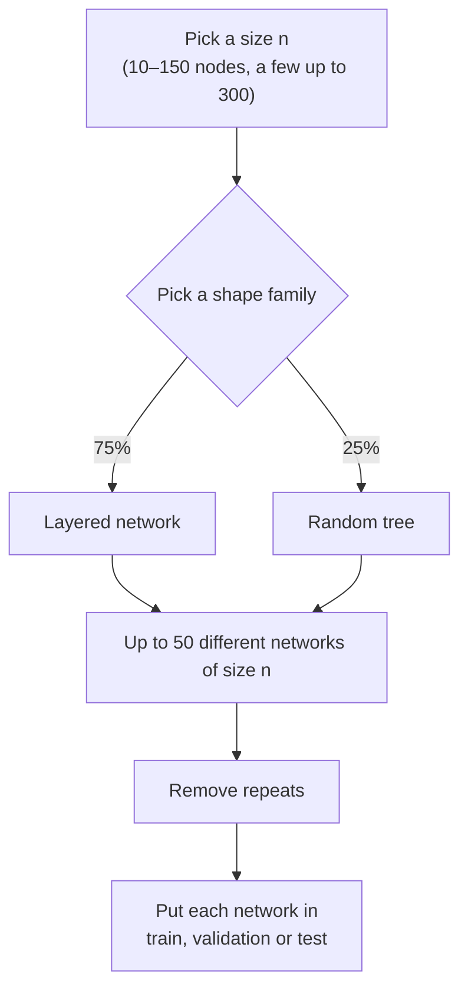
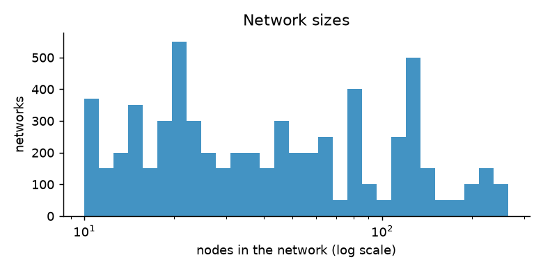
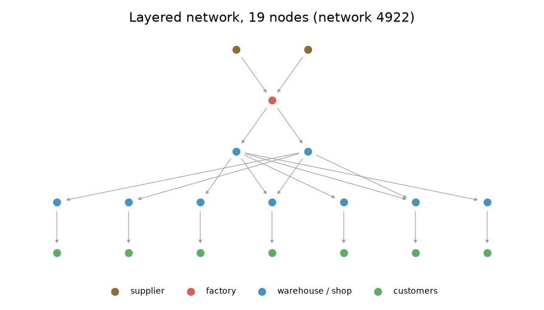
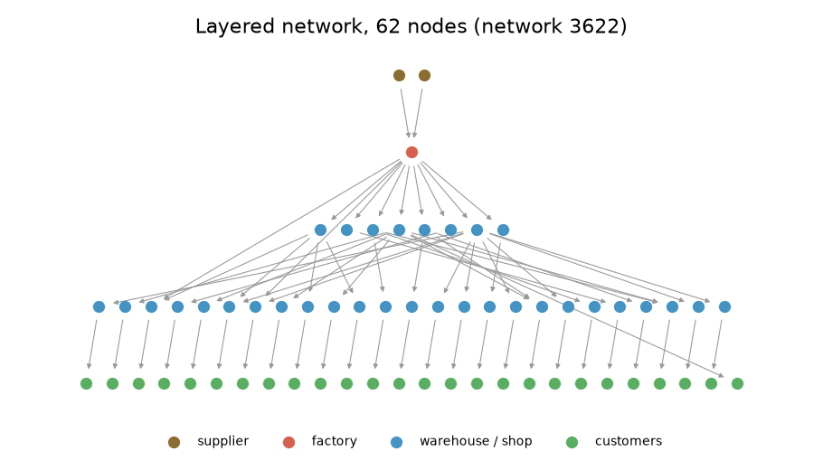
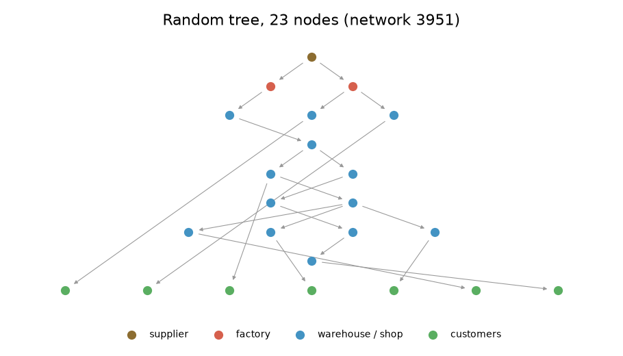

# How a network is built

A **network** is the map of who supplies whom. It has five kinds of node:

| Letter | Node | What it does |
|---|---|---|
| S | Supplier | Provides one raw material |
| M | Factory (manufacturer) | Turns raw materials into the product |
| I | Warehouse (DC) or shop | Holds stock and sells it on |
| D | Customers | A stream of customer orders at one shop |

There is a **single product**. Every factory makes the same product, and every warehouse and shop
stocks it. Goods flow from suppliers down to customers; orders flow the other way.

The code for this page is in `generator/topology.py` and `generator/dataset.py`.

## Step by step

### 1. Pick the size

The size n (number of nodes) is a whole number from 10 to 150. It is drawn on a **log scale**, so small
and large sizes are equally common in ratio terms: 10–20 nodes is as likely as 75–150 nodes. This gives
many small, cheap networks and still a good number of big ones.

About 5% of sizes are drawn again between 150 and 300 nodes and marked `size_band = large`. They test
whether a model trained on smaller networks still works on bigger ones.

### 2. Pick the shape family

- **Layered network (75%).** Suppliers → factories → 0 to 3 layers of warehouses → shops → customers.
  This is how most real supply chains are organised [^chopra].
- **Random tree (25%).** A tree (each node has one supplier) of any shape, drawn so that every possible
  tree with that mix of node types is equally likely. These are often deep and thin, and serve as an
  "unusual shape" test.

### 3. Build a layered network

1. **How many warehouse layers.** 0, 1, 2 or 3 layers, with chances 20%, 40%, 30% and 10%.
2. **How wide each layer is.** Each layer is 2 to 20 times wider than the layer above it. Then all
   layers are shrunk by the same factor until the total equals n exactly. A warehouse layer that becomes
   too thin is dropped. There are 0.7 to 2.5 suppliers per factory.
3. **One supplier for every site.** Every node gets one supplier in the layer above. Some suppliers
   get many children and some only a few, as in real life ("rich get richer" choice).
4. **Extra links.** The chance of each kind of extra link is drawn separately for each network:

    | Extra link | What it means | Chance per site |
    |---|---|---|
    | Second supplier | A warehouse or shop buys from two places in the layer above | 10%–30% |
    | Skip link | A site buys from two or more layers up, for example factory → shop | 0%–8% |
    | Shared supplier | A factory also uses a supplier that already serves another factory | 5%–30% |
    | Warehouse with own customers | A warehouse also sells straight to customers | 0%–15% |

5. **Customers.** Every shop gets one customer stream.

<figure markdown>

<figcaption>A small layered network: two suppliers, one factory, one warehouse layer and seven shops.
Several shops buy from both warehouses.</figcaption>
</figure>

<figure markdown>

<figcaption>A medium layered network. Note the skip links (factory straight to a shop).</figcaption>
</figure>

<figure markdown>

<figcaption>A random tree: every node has exactly one supplier.</figcaption>
</figure>

### 4. Remove repeats

For each size, up to 50 different networks are made. Two networks count as **the same** if they have
the same shape and the same node types in the same places. This is checked with a graph fingerprint,
the Weisfeiler–Lehman hash [^wl]. Within one draw, repeats are thrown away. The same size can be drawn
more than once, so a network can still match one from another draw. Such a network is kept, but marked
in the `dup_of` column with the id of the first copy, so it is easy to skip.

### 5. Split for machine learning

Each network goes to **training (70%)**, **validation (15%)** or **testing (15%)**. The choice comes from
the network's fingerprint, so identical networks always land in the same group. A model is therefore
never tested on a network shape it was trained on.

## How often each feature appears

--8<-- "generated/feature_shares.md"

!!! note "Known gap"
    Three warehouse layers are rarer than planned, because the shrinking step in 3.2 often drops the
    thinnest layer. A fix is planned for a later version.

[^chopra]: S. Chopra and P. Meindl, *Supply Chain Management: Strategy, Planning, and Operation*, Pearson (any recent edition), chapter on designing distribution networks.
[^wl]: N. Shervashidze, P. Schweitzer, E. J. van Leeuwen, K. Mehlhorn and K. M. Borgwardt, "Weisfeiler-Lehman Graph Kernels", *Journal of Machine Learning Research* 12, 2011. As implemented in NetworkX: <https://networkx.org/documentation/stable/reference/algorithms/generated/networkx.algorithms.graph_hashing.weisfeiler_lehman_graph_hash.html>
