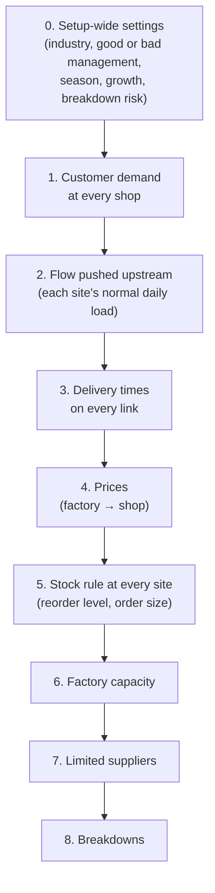

# How the numbers are chosen

Once the network is fixed, every node and link needs numbers: how much customers buy, how long
deliveries take, when to reorder, how big the factory is, what things cost. This page explains where
each number comes from. The code is `configure()` in `generator/chain.py`.

!!! tip "The main idea: customers first, everything else follows"
    Customer demand is drawn first. It is then **pushed up the network**, so each site knows how much it
    must carry on a normal day. Stock levels, factory size, prices and freight are all worked out from
    that flow. A big shop therefore gets a big stock and a busy factory gets a big machine. Nothing is
    random on its own, so the numbers always fit together.

## The order of filling

## 0. Setup-wide settings

Before any node is filled, a few settings are drawn once for the whole setup. They are stored in the
`configs` table.

- **Industry**: groceries (FMCG), electronics, medicines (pharma) or industrial spare parts. Each
  industry has its own number ranges (table below).
- **Stress or control.** 80% of setups are **stress** setups: they may forecast badly, run price wars or
  aim for low stock levels, so failures happen. 20% are **control** setups: honest forecasts, normal
  prices and a 90%, 95% or 98% service target, the usual range in practice [^king]. The `regime`
  column tells them apart.
- **Season** (70% of setups): demand goes up and down once a year, usually by up to ±50% (a few streams up to ±75%).
- **Growth**: demand grows or shrinks by −10% to +20% a year.
- **Breakdown risk** (60% of setups): some sites break down now and then.
- **Limited suppliers** (50% of setups): some suppliers can run out.

## 1. Customer demand

Each customer stream gets:

| Number | How it is chosen |
|---|---|
| Average units per day | Drawn around the industry's typical value (a log-normal spread) |
| Orders per day | Drawn from the industry's range. Average order size = units ÷ orders |
| Order size | Varies around its average. How much it varies depends on the industry (industrial orders are the lumpiest) |
| Season and growth | The setup's season and growth, with a small change per stream |

Customers arrive at random times (a Poisson process [^ross]), faster in the busy season. A customer
takes what is on the shelf. If the shelf is short, the rest of the order is **lost**. Customers never
wait.

## 2. Flow pushed upstream

Each site's **flow** is the average number of units it must pass on per day:

- A shop's flow = its customers' demand.
- A warehouse's flow = the share of its children's flow that it supplies.
- A factory's flow = what its warehouses take from it.
- A supplier's flow = the factory's flow × units of raw material per product (the **recipe**, 1 to 3).

A site with two suppliers splits its orders at random with fixed weights. The main supplier gets 50% to
90% of orders.

## 3. Delivery times

Every link gets a delivery time drawn from its industry's range (table below). Each shipment's actual
time varies around that average (a gamma distribution), by an amount that is also drawn per setup.
A factory needs all its raw materials, so its planning time is the **longest** of its inbound
deliveries, plus the time to make a batch.

## 4. Prices

- Suppliers sell raw material at a price from the industry range.
- A factory's cost per unit = raw materials + making cost.
- The shop price is the factory cost × a markup. The markup is drawn per setup and split along the
  chain between the factory, the warehouses and the shop.
- Stress setups may squeeze the markup almost to zero (a price war), so some of them lose money.
- **Holding cost**: keeping one unit in stock for a year costs 10% to 40% of its value. The lower end
  matches the median measured by APQC across 6,468 organisations [^apqc].
- **Freight**: each delivery costs a fixed amount plus a small share (0.3% to 3%) of the value of the
  goods.

## 5. Stock rule at every site

Every factory, warehouse and shop follows the **(s, S) rule**, the standard textbook stock rule [^silver]:

> Check stock every *r* days. If the stock position has fallen to the **reorder level s** or below,
> order enough to bring it back up to the **order-up-to level S**.

The *stock position* is the stock on the shelf, plus what is already on its way, minus what is still
owed to others.

How s and S are worked out:

1. **Forecast.** The planner's estimate of daily demand. In stress setups it is often too low (by up to
   about 50%). In control setups it is right on average.
2. **Cover for the delivery time.** s must cover the forecast demand during the delivery time plus the
   review period, plus a safety margin for surprises:

    $$ s = \hat D\,(L + r) + z \sqrt{(L + r)\,\sigma_D^2 + \hat D^2\,\sigma_L^2} $$

    where $\hat D$ is the forecast per day, $L$ the delivery time, $r$ the review period, $\sigma_D^2$
    and $\sigma_L^2$ the variances of daily demand and delivery time, and $z$ the **safety factor** set by
    the service target (for example 95% → z ≈ 1.64). This is the usual safety-stock formula [^king].
3. **Order size Q = S − s.** Chosen so that ordering costs and holding costs are balanced, in the style
   of the economic order quantity (EOQ) [^harris], then allowed to vary.
4. **Never too small for the children.** A warehouse's s is at least the biggest order one of its
   children places, so a single child order never empties it by surprise.

Every site starts the simulation with S units on the shelf.

## 6. Factory capacity

A factory makes one batch at a time. The batch size is set so that, on a normal day, the factory is
busy **60% to 97%** of the time. For comparison, Indian manufacturing as a whole ran at 74.6% of capacity
in early 2026 [^rbi].

Capacity is sized for **normal** demand. The busy season and demand growth can push a factory above
its limit. How far is recorded in `peak_load` (above 1 means it cannot keep up at the peak).

## 7. Limited suppliers

In half of the setups, some suppliers are **limited**. They produce raw material at a fixed rate
(3% to 67% above their normal flow) into a store of limited size. If factories need more than that for
long enough, the supplier runs out.

The store holds 7 to 30 days of flow, and at least enough to fill the **largest single order** a
factory can ever send it. That second rule matters: in SupplyNetPy an order is shipped whole, so an order
bigger than the whole store could never be filled and the factory would stop for good.

## 8. Breakdowns

In 60% of setups, each supplier, factory and warehouse (without its own customers) may break down,
with a chance of 20% to 70% per site. A site that can break down does so every 180 to 1,500 days on
average, and each breakdown lasts 2 to 30 days on average. The time between breakdowns is random
(exponential). Breakdown lengths have a long tail, so a rare breakdown can last several months. For
comparison, the 2021 fire at the Renesas Naka chip plant took about 97 days to recover from [^renesas].

During a breakdown a site takes **no new orders**. Shipments already on the road still arrive.

## The four industries

The rules above are the same for every industry. Only the ranges change:

| | Groceries (FMCG) | Electronics | Medicines (pharma) | Industrial spare parts |
|---|---|---|---|---|
| Typical demand per customer stream | 40 units/day | 8 units/day | 15 units/day | 2 units/day |
| Customer orders per day | 2–6 | 0.5–2 | 1–3 | 0.1–0.8 (few, large orders) |
| Delivery time, supplier → factory | 2–10 days | 14–45 days | 30–90 days | 7–30 days |
| Delivery time, factory → warehouse | 1–5 days | 5–30 days | 3–10 days | 3–14 days |
| Delivery time, warehouse → shop | 1–3 days | 2–7 days | 1–4 days | 2–7 days |
| Raw material price per unit | 0.2–2 | 10–120 | 2–40 | 20–400 |
| Shop price ÷ factory cost | 1.5–2.4 | 1.3–2.0 | 1.8–4.5 | 1.6–3.5 |
| Holding cost per year (share of value) | 10%–30% | 10%–40% | 10%–30% | 10%–35% |
| Average service target | 50%–99% | 50%–98% | 70%–99.5% | 50%–98% |
| Freight (share of goods value) | 1%–3% | 0.5%–2% | 0.3%–1% | 1%–3% |
| Unit | consumer pack | device | strip / pack | part |

Money has no currency. Each setup uses its own price units, set by its raw-material price.

!!! info "Where these ranges come from"
    The ranges are reasoned design choices, chosen to be plausible for each industry and wide enough to
    give variety. They are **not** fitted to data. The few that were checked against public figures are
    listed in [Assumptions and limits](assumptions.md#checked-against-public-figures).

[^ross]: S. M. Ross, *Introduction to Probability Models*, Academic Press (any recent edition), chapter on the Poisson process.
[^silver]: E. A. Silver, D. F. Pyke and D. J. Thomas, *Inventory and Production Management in Supply Chains*, 4th ed., CRC Press, 2017. The (s, S) policy was shown to be optimal under broad conditions by H. Scarf, "The optimality of (S, s) policies in the dynamic inventory problem", 1960.
[^king]: P. L. King, "Understanding safety stock and mastering its equations", *APICS Magazine*, July/August 2011. <https://web.mit.edu/2.810/www/files/readings/King_SafetyStock.pdf>
[^harris]: F. W. Harris, "How many parts to make at once", *Factory, The Magazine of Management* 10(2), 1913 (the original EOQ). See also C. Caplice, *Inventory Management*, MIT OpenCourseWare ESD.260, lecture 11, 2006. <https://ocw.mit.edu/courses/esd-260j-logistics-systems-fall-2006/8b53c45fd26ffff706d815131e8d177e_lect11.pdf>
[^apqc]: APQC, "Inventory carrying cost as a percentage of inventory value" (measure 100784). <https://www.apqc.org/what-we-do/benchmarking/open-standards-benchmarking/measures/inventory-carrying-cost-percentage>
[^rbi]: Reserve Bank of India, Order Books, Inventories and Capacity Utilisation Survey (OBICUS), Q1 2026-27: 74.6% (76.3% seasonally adjusted). <https://www.rbi.org.in/scripts/PublicationsView.aspx?id=24087>
[^renesas]: Renesas Electronics, "Update 10: Notice regarding the semiconductor manufacturing factory (Naka Factory) fire", 2021. <https://www.renesas.com/en/about/press-room/update-10-notice-regarding-semiconductor-manufacturing-factory-naka-factory-fire-production-capacity>
