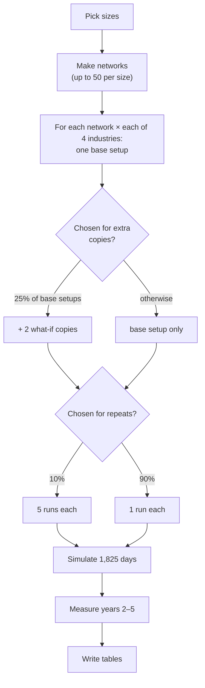
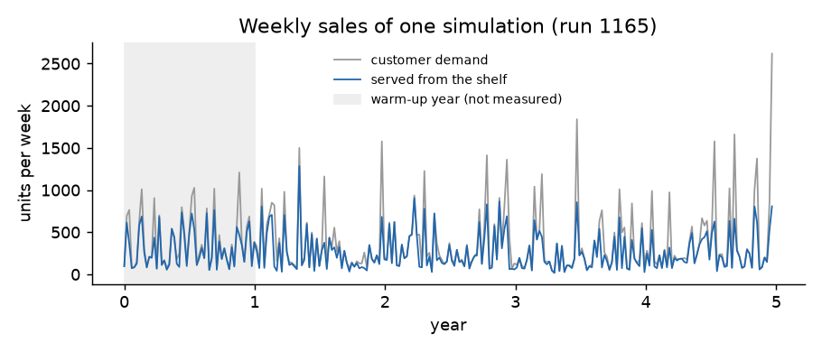
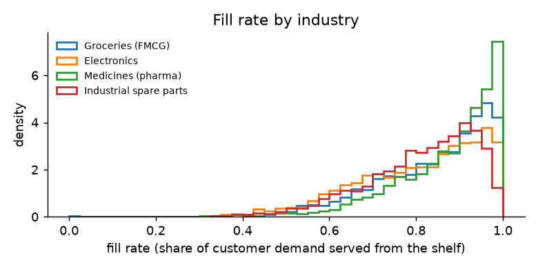
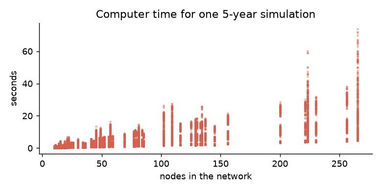

# How a simulation runs

A **setup** (a network with all its numbers) is handed to SupplyNetPy and played out for **5 years
(1,825 days)**. One such play-out is a **run**. This page explains how long a run is, how many runs each
setup gets, and what is measured.

## The whole pipeline

Everything random comes from one starting number (the **seed**). The same seed always gives the same
dataset, on any computer and with any number of parallel workers.

## One run, day by day

1. Build the SupplyNetPy network from the setup.
2. Give every node, link and customer stream its **own random stream**. This keeps them independent,
   and it is what makes the what-if copies fair (see below).
3. For each day 1 … 1,825: run the simulation to the end of the day, then record the network's totals
   for that day: demand, sales, stock, money in and money out.
4. At the end of the warm-up and at the end of the run, record every node's counters.
5. Work out the results (below).

## Why 5 years, and why throw away the first

Every site starts with a full shelf (S units), and that stock is free. The first year is therefore
unrealistically good: in a pilot study, year 1 showed a profit margin **8.4 percentage points** too high.
From year 2 on, results settled within ±0.6 points of later years. So:

- **Year 1 is warm-up.** It is simulated, but left out of every result.
- **Years 2 to 5 are measured.** That is 4 whole years, so every season is counted the same number of
  times and seasonal demand does not bias the averages.

Four measured years were enough to make the typical run's profit estimate accurate to within about 1%
of its revenue. A fifth year would have improved that by only 0.1 points for 25% more computing.

Each run also gets an automatic warm-up check, **MSER-5** [^mser]. It finds the point after which the
weekly profit series looks settled. The column `warmup_ok` says whether that point falls inside the
first year.

## Repeats: how much is luck?

10% of base setups are run **5 times** with the same numbers but different random luck (different
customer arrivals, delivery times and breakdowns). This shows how much a result changes by chance alone.
In the demo build, the fill rate of the best and worst of 5 repeats differed by about 2 percentage
points.

## What-if copies: cause and effect

25% of base setups get **2 what-if copies**. A copy is the same setup with exactly one change:

| Change | What is done |
|---|---|
| **Breakdown** | One supplier, factory or warehouse is shut for 14–90 days, starting at a random day in the measured years |
| **Smaller factory** | One factory's batch size is cut to 30%–90% |
| **Different safety stock** | One site's safety factor z is raised or lowered by 0.5–1.5 |

The copy uses the **same random luck** as its base: the very same customers arrive at the very same
times. So the difference between a copy and its base is caused by the change alone. The columns
`variant`, `variant_node`, `variant_start` and `variant_value` describe the change, and
`base_config_id` points to the base.

## What is measured

All results cover the **measured window only** (years 2–5).

**For the whole network** (`runs` table, columns starting with `main_`):

| Result | Meaning |
|---|---|
| `main_fill` | **Fill rate**: share of customer demand served straight from the shelf |
| `main_profit_day` | Profit per day: sales to customers minus all costs (raw material, making, holding, freight). Sales between sites of the same network cancel out |
| `main_margin` | Profit ÷ sales |
| `main_ext_revenue_day` | Sales to customers per day |
| `main_holding_day`, `main_transport_day`, `main_raw_day`, `main_mfg_day` | The cost parts |
| `main_avg_inventory` | Average units in stock at factories, warehouses and shops |
| `main_stockout_share` | Share of days a customer-facing site ended with an empty shelf |
| `main_outage_days` | Total days of breakdown, over all nodes |

**For every node** (`node_results` table): its own fill rate, demand, shortage, units shipped, average
stock, money in and out, breakdown days and, for factories and warehouses, the real delivery time it saw.

**Day by day** (`series` table): the network's daily customer demand, sales, revenue, cost, profit,
stock and unshipped orders, for all 1,825 days, warm-up included.

## Results at a glance

--8<-- "generated/results.md"

*Typical* means the median. *Fill rate below 0.7* means less than 70% of customer demand was served.

Stress setups fail much more often than control setups, as intended. Electronics loses money most often,
because its margins are the thinnest.

## Cost of a run

A 5-year run takes about **0.07 seconds of computer time per node**: about 3.5 s for a 50-node network
and 10 s for a 150-node one.

[^mser]: K. P. White Jr., "An effective truncation heuristic for bias reduction in simulation output", *Simulation* 69(6), 1997, pp. 323–334. See also K. P. White Jr., M. J. Cobb and S. C. Spratt, "A comparison of five steady-state truncation heuristics for simulation", *Proceedings of the 2000 Winter Simulation Conference*.
