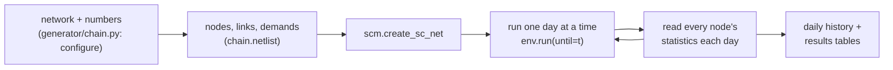

# SupplyNetPy

## What it is

[SupplyNetPy](https://supplychainsimulation.github.io/SupplyNetPy/) is an open-source Python library for
building and simulating supply chains [^snp]. It is developed at IIT Goa by Tushar Lone, Lekshmi P and
Prof. Neha Karanjkar, and is free to use from PyPI (`pip install supplynetpy`).

It is a **discrete-event simulator**: instead of moving the clock forward in fixed steps and checking
everything, it jumps from one event to the next (an order arrives, a truck delivers, a machine finishes
a batch). This is exact and fast. It is built on SimPy, a well-known Python library for this kind of
simulation [^simpy].

## Why it is useful here

- **Any network shape.** A supply chain is described as a list of nodes and links, so a program can
  build thousands of different networks automatically. This was one of the library's design goals [^snp].
- **Ready-made parts.** Suppliers, factories, warehouses, customers, delivery links, stock rules and
  breakdowns already exist and are tested. We do not write a simulator from scratch.
- **Checked against known answers.** Its authors validated it against textbook formulas, a commercial
  simulation tool and a published case study [^snp].
- **Detailed statistics.** Every node keeps counters (units ordered, shipped, lost, money spent and
  earned), which we read out to build the results.

Before using it at scale, we tested it on many networks and reported 11 issues in multi-level networks
upstream (issue #1 and pull request #2 on the SupplyNetPy GitHub). They were fixed in versions 0.2.0
and 0.2.1. This dataset uses **version 0.2.2**, pinned, with no changes to the library [^repo].

## How it is used

Each simulated supply chain is handed to SupplyNetPy as three lists: **nodes**, **links** and
**demands**. The parts used are:

| SupplyNetPy part | Used for | What we set |
|---|---|---|
| `infinite_supplier` | A supplier that never runs out | raw-material price |
| `supplier` (finite) | A supplier that produces raw material at a fixed rate into a limited store | rate, store size |
| `manufacturer` | A factory that turns raw materials into the product, one batch at a time | recipe, batch size, batch time, stock rule, costs |
| `warehouse` | A distribution centre (DC) or shop that holds stock and reorders | stock rule, buy and sell price, holding cost |
| `Link` | A delivery route between two nodes | delivery-time distribution, cost per order |
| `Demand` | A stream of customer orders at a shop | when orders arrive, how big they are |
| `SSReplenishment` | The stock rule at every factory, DC and shop: the **(s, S) policy** | reorder level s, order-up-to level S, review period |
| node disruption | Random or planned breakdowns | when they start, how long they last |

One part is our own: `WeightedSelect`, a small supplier-choice rule. When a site has two suppliers, it
sends each order to one of them at random, using fixed weights (for example 70% / 30%). It is written as
a SupplyNetPy `SupplierSelectionPolicy`, the library's intended way to extend this.

A tiny example of the same building blocks (adapted from the SupplyNetPy quick start [^snpdocs]):

```python
import SupplyNetPy.Components as scm

supplier = {"ID": "S1", "name": "Supplier", "node_type": "infinite_supplier"}
shop = {"ID": "R1", "name": "Shop", "node_type": "warehouse",
        "capacity": float("inf"), "initial_level": 50, "inventory_holding_cost": 0.2,
        "replenishment_policy": scm.SSReplenishment, "policy_param": {"s": 40, "S": 120},
        "product_buy_price": 100, "product_sell_price": 105}
link = {"ID": "L1", "source": "S1", "sink": "R1", "cost": 5, "lead_time": lambda: 2}
customers = {"ID": "d1", "name": "Customers", "demand_node": "R1",
             "order_arrival_model": lambda: 1, "order_quantity_model": lambda: 10}

net = scm.create_sc_net(nodes=[supplier, shop], links=[link], demands=[customers])
net["env"].run(until=365)            # one simulated year
print(net["nodes"]["R1"].stats.demand_fulfilled)
```

The dataset does the same thing, at a larger scale and with every number filled in by rules:



Running one day at a time lets us record the network's daily history (sales, stock, profit) without
changing anything inside SupplyNetPy.

!!! note "Settings that keep the simulation safe"
    A few library features are used in a fixed way, to avoid known edge cases:
    customers never wait (unserved demand is lost), recipes use whole numbers, and site storage space is
    unlimited (factories are limited by how fast they can produce instead). See
    [Assumptions and limits](assumptions.md).

[^snp]: T. Lone and N. Karanjkar, "SupplyNetPy: An Open-Source Python Library for High-Fidelity Modeling and Simulation of Arbitrary Supply Chain and Inventory Networks", arXiv:2607.09745, 2026. <https://arxiv.org/abs/2607.09745>
[^simpy]: SimPy, discrete-event simulation for Python. <https://simpy.readthedocs.io/>
[^repo]: SupplyNetPy source code and issue tracker. <https://github.com/SupplyChainSimulation/SupplyNetPy>
[^snpdocs]: SupplyNetPy documentation. <https://supplychainsimulation.github.io/SupplyNetPy/>
